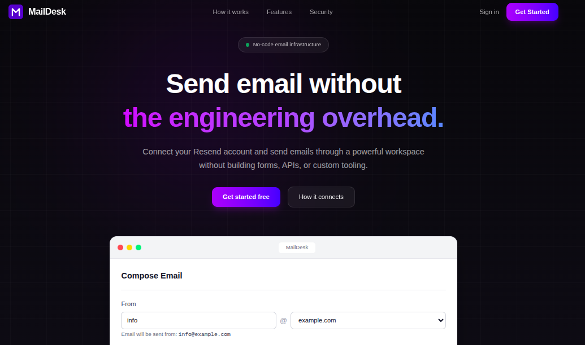
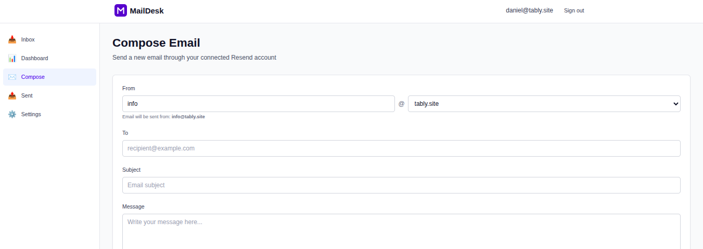

<p align="center">
  <picture>
    <source media="(prefers-color-scheme: dark)" srcset="files/maildesk-logo-dark.svg">
    
  </picture>
</p>

<p align="center">
  <strong>No-code email platform on top of Resend</strong><br>
  Send and receive email from a clean Gmail-style inbox — without writing a single API call.
</p>

<p align="center">
  <a href="https://inbound.tably.site"><strong>Live Demo</strong></a> &nbsp;•&nbsp;
  <a href="#features">Features</a> &nbsp;•&nbsp;
  <a href="#getting-started">Getting Started</a> &nbsp;•&nbsp;
  <a href="#roadmap">Roadmap</a>
</p>

<p align="center">
  
  
  
  
  
  
</p>

---

## Why MailDesk?

Most developers either write custom code against the Resend API every time, or end up using heavy tools that are overkill for simple sending + receiving.

**MailDesk** sits in the middle:

- Connect your own Resend account once
- Send and receive email through a familiar inbox UI
- No code required after the initial setup

Perfect for solo founders, indie hackers, and small teams who want branded email without building infrastructure.

---

## Screenshots

### Landing Page


### Compose Email


---

## Features

### Core Experience
- **Connect your Resend account** — API key stored encrypted (AES-256-GCM), never sent to the browser
- **Per-domain keys** — assign different keys to different sending domains or keep one account-wide key
- **Clean composer** — select verified domain + sender, write your email, hit send
- **Inbox** — receive email at generated inbound addresses via Resend webhooks (with read/unread state)
- **Sent history** — track delivery status of every email you send
- **User accounts** — email + password auth, fully multi-tenant

### Security
- Resend API keys encrypted at rest with **AES-256-GCM** (PBKDF2 key derivation + random salt/IV)
- Passwords hashed with bcrypt
- Inbound webhooks verified with Resend’s signing secret
- Strict per-user data isolation
- Rate limiting on sending (10 emails / minute per user)

---

## Tech Stack (v1 — currently in production)

| Layer       | Choice                                      |
|-------------|---------------------------------------------|
| Framework   | Next.js 16 (App Router) + React 19          |
| Language    | TypeScript                                  |
| Styling     | Tailwind CSS 4                              |
| Auth        | NextAuth.js v4 (credentials + JWT)          |
| Database    | PostgreSQL (Supabase) + Prisma 5            |
| Email       | Resend (outbound API + inbound webhooks)    |
| Validation  | Zod                                         |
| Hosting     | Vercel                                      |

---

## Live Demo

→ **[https://inbound.tably.site](https://inbound.tably.site)**

Sign up, connect a Resend API key, and start sending/receiving immediately.

---

## Getting Started

### Prerequisites
- Node.js 22+
- A PostgreSQL database (local or free Supabase project)
- A Resend account

### Setup

```bash
git clone https://github.com/Danny7d/MailDesk.git
cd MailDesk
npm ci
cp .env.example .env
```

Fill in the environment variables (see table below), then:

```bash
npx prisma migrate dev
npx prisma generate
npm run dev:legacy
```

Open [http://localhost:3000](http://localhost:3000).

> **Note:** `npm run dev:legacy` starts the currently deployed v1 app.  
> Plain `npm run dev` starts the v2 Turborepo workspace (still in progress).

### Environment Variables

| Variable                  | Purpose                                                                 |
|---------------------------|-------------------------------------------------------------------------|
| `DATABASE_URL`            | Runtime DB URL. On Supabase use the **transaction pooler** (`:6543`) with `?pgbouncer=true&connection_limit=3` |
| `DIRECT_URL`              | Used for migrations (Supabase session mode / `:5432`)                   |
| `AUTH_SECRET`             | Session signing secret (`openssl rand -base64 32`)                      |
| `ENCRYPTION_KEY`          | Key material for encrypting users’ Resend API keys                      |
| `NEXT_PUBLIC_APP_URL`     | Public base URL (e.g. `http://localhost:3000`)                          |
| `RESEND_API_KEY`          | MailDesk’s **own** Resend key (for inbound email)                       |
| `RESEND_WEBHOOK_SECRET`   | Signing secret from the Resend webhook (`whsec_...`)                    |
| `MAILDESK_INBOUND_DOMAIN` | Domain used to generate inbound addresses                               |

### Testing inbound email locally

Resend needs a public URL for webhooks. Expose your local server:

```bash
ngrok http 3000
# or
cloudflared tunnel --url http://localhost:3000
```

1. In [Resend Webhooks](https://resend.com/webhooks) add `https://<your-tunnel>/api/webhooks/resend` and select the `email.received` event.
2. Copy the signing secret into `RESEND_WEBHOOK_SECRET`.
3. Sign up at `/signup` — you’ll get an inbound address.
4. Send an email to that address. It should appear in `/dashboard/inbox`.

---

## Architecture Notes

### Prisma + Serverless Postgres (important)

The app runs on Vercel (serverless). Connections go through Supabase’s transaction pooler (PgBouncer on port `6543`). Prisma’s named prepared statements can collide in transaction mode, causing intermittent `prepared statement "s0" already exists` errors.

**Fix:**

```
DATABASE_URL = ...pooler.supabase.com:6543/postgres?pgbouncer=true&connection_limit=3
DIRECT_URL   = ...pooler.supabase.com:5432/postgres
```

- `DATABASE_URL` → runtime queries  
- `DIRECT_URL` → migrations (needs a real session)

See `prisma.config.ts` for the exact setup.

---

## Roadmap

A **v2 rebuild** is in progress as a Turborepo monorepo:

- Fastify API
- BullMQ worker + Redis
- PostgreSQL with Drizzle
- Structured logging & metrics
- Proper multi-tenant isolation
- Queued sending with retries
- Shared rate limiter

Current status: walking skeleton (not deployed yet).

- Local setup: [`docs/v2-development.md`](docs/v2-development.md)
- Design docs: [`docs/architecture/`](docs/architecture/)

---

## Contributing

Contributions are welcome!

1. Fork the repo
2. Create a feature branch (`git checkout -b feature/amazing-feature`)
3. Commit your changes
4. Open a Pull Request

Looking for something to work on? Check the [open issues](https://github.com/Danny7d/MailDesk/issues) or the roadmap above.

---

## License

MIT © [Daniel Tadesse](https://github.com/Danny7d)

---

<p align="center">
  Built with ❤️ in Addis Ababa 🇪🇹
</p>
